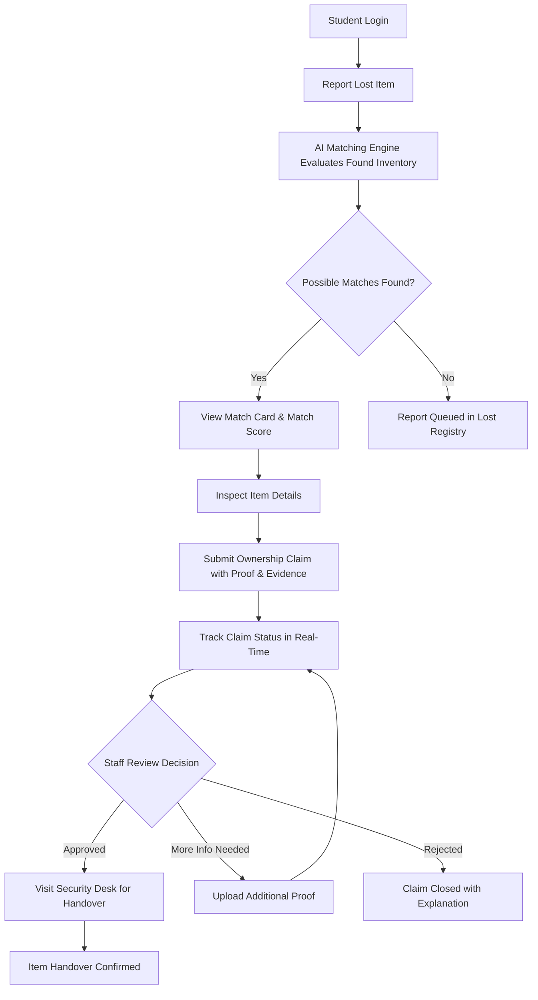
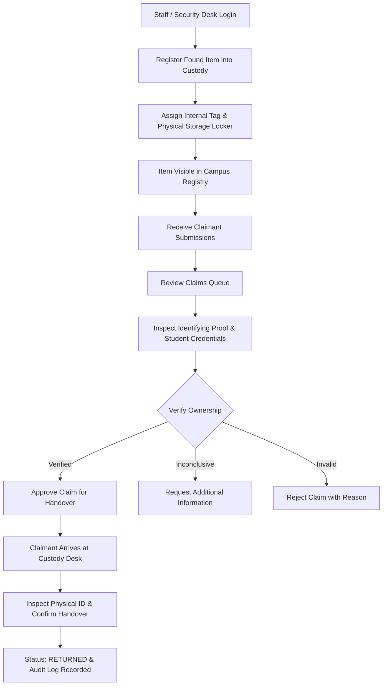
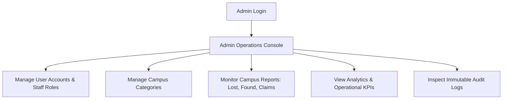

# CampusFind System Workflows

This document outlines the end-to-end lifecycle and role workflows in the CampusFind enterprise application.

---

## 1. Student Workflow

### Steps:
1. **Report Lost Item**:
   - The student navigates to `/student/report-lost`.
   - Fills in item name, category, distinctive colors/brands, timestamp, lost campus zone/room, and optional reference photos.
2. **Receive Possible Match**:
   - The system triggers the automated matching algorithm (`matchingService.js`), which calculates a match score (0-100%) against all items currently in custody.
   - Immediate matching cards appear displaying reasons (e.g., category match, color match, location proximity).
3. **Submit Claim**:
   - The student selects a found item to claim via `/student/claim/:id`.
   - Provides private identifying details that are not visible in public listings (e.g., specific serial digits, unique marks, lock screen wallpaper, invoice receipt).
4. **Track Status**:
   - The student views real-time progress via `/student/my-claims`.
   - Status transitions: `pending` → `under_review` → `additional_information_requested` (if needed) → `approved` → `completed` (handed over).

---

## 2. Staff Workflow

### Steps:
1. **Register Found Item**:
   - Staff member logs in and accesses `/staff/register-found`.
   - Inputs internal description, safe storage location (e.g., `Locker B-04, Security Office`), category, date found, and location recovered.
   - Storage locker details remain confidential to prevent unauthorized claims.
2. **Review Claims**:
   - Staff monitors incoming claims in `/staff/claims`.
   - Compares claimant's submitted evidence against hidden physical attributes and logs.
3. **Verify Ownership**:
   - Staff marks claim status:
     - `under_review`: Examination underway.
     - `additional_information_requested`: Claimant notified to submit further documentation.
     - `approved`: Ownership verified; item scheduled for retrieval.
     - `rejected`: Incompatible evidence.
4. **Confirm Handover**:
   - Claimant presents their College ID at the custody desk.
   - Staff verifies physical presence, enters handover remarks on `/staff/claims/:id/handover`, and marks the transaction as complete.
   - Item status transitions to `returned`, triggering an audit log and confirmation notification.

---

## 3. Admin Workflow

### Steps:
1. **Manage Accounts & Categories**:
   - **Users & Staff**: In `/admin/users` and `/admin/staff`, admin provisions staff accounts, adjusts roles, and manages student access status (`active`, `suspended`).
   - **Categories**: In `/admin/categories`, admin creates, renames, and updates icons for campus-specific categories (Electronics, ID Cards, Keys, Books, etc.).
2. **Monitor Reports**:
   - Administrative oversight of all reports via `/admin/lost-items`, `/admin/found-items`, and `/admin/claims`.
   - Authority to moderate reports, resolve disputes, or reassign claims.
3. **View Analytics & Audit Logs**:
   - **Analytics** (`/admin/analytics`): Visual charts on return recovery rate, category distributions, monthly resolution velocity, and hotspot recovery locations.
   - **Audit Logs** (`/admin/audit-logs`): Full non-repudiation audit trail recording every critical action (actor, IP/timestamp, item ID, action taken).
